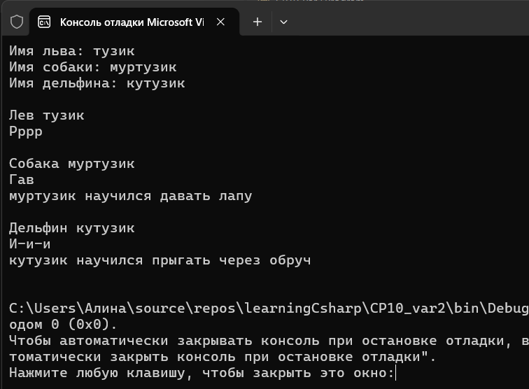



Вариант 2. Зоопарк

IAnimal { string Name { get; } void MakeSound(); } — базовый интерфейс.
ITrainable : IAnimal { string Train(); } — расширяющий интерфейс, возвращающий результат обучения трюку.
Реализуйте Lion, реализующий только IAnimal.
Реализуйте Dog и Dolphin, реализующие ITrainable (а значит, и IAnimal).
Соберите всех животных в List<IAnimal>, обойдите в цикле: выведите имя и звук каждого, а для тех, что дополнительно реализуют ITrainable (проверка через is), дополнительно выведите результат Train().

Проверочные ключи

Список из Lion, Dog, Dolphin:

Lion — выводится Name и MakeSound(); Train() не вызывается
Dog — выводится Name, MakeSound() и дополнительно Train()
Dolphin — выводится Name, MakeSound() и дополнительно Train()
