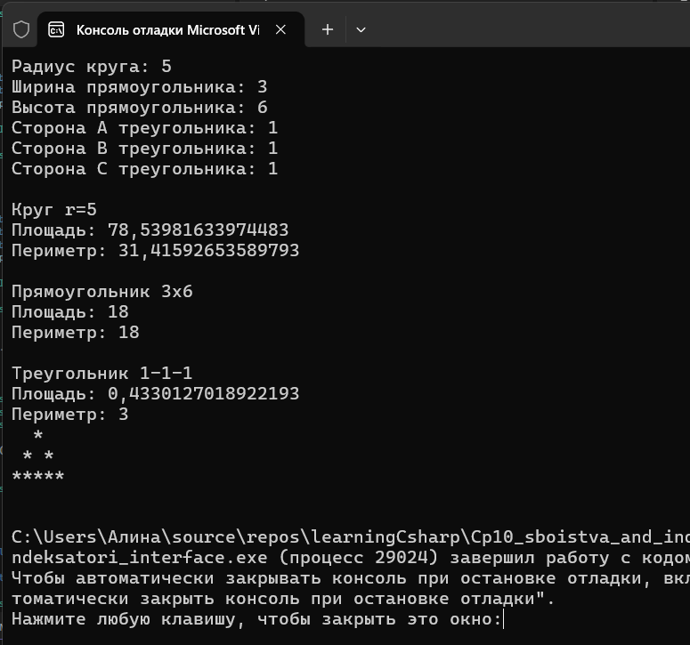



Вариант 1. Геометрические фигуры

IShape { double Area(); double Perimeter(); } — базовый интерфейс.
IDrawable : IShape { string Draw(); } — расширяющий интерфейс, возвращающий текстовое представление фигуры (например, упрощённый ASCII-рисунок).
Реализуйте Circle и Rectangle, реализующие только IShape.
Реализуйте Triangle, реализующий IDrawable (а значит, и IShape).
Соберите все фигуры в List<IShape>, обойдите в цикле: выведите площадь и периметр каждой, а для тех, что дополнительно реализуют IDrawable (проверка через is), дополнительно выведите результат Draw().

Проверочные ключи

Список из Circle, Rectangle, Triangle:

Circle — выводятся Area() и Perimeter(); Draw() не вызывается
Rectangle — выводятся Area() и Perimeter(); Draw() не вызывается
Triangle — выводятся Area(), Perimeter() и дополнительно Draw()
