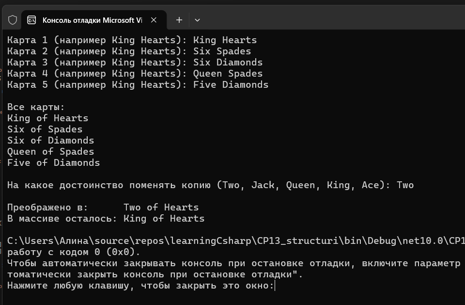
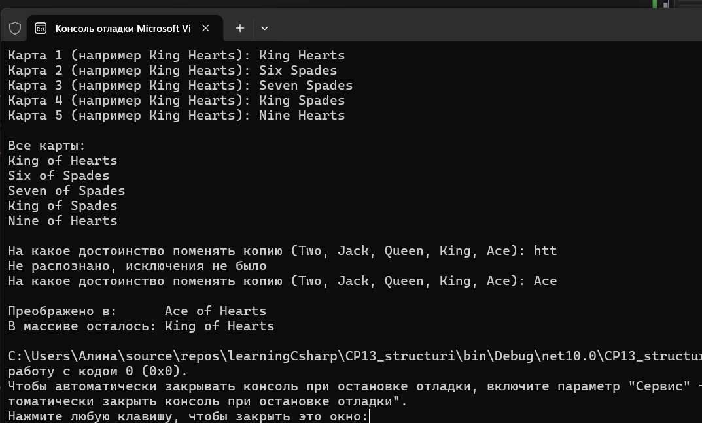



Вариант 1. Игральная карта

enum Suit { Clubs, Diamonds, Hearts, Spades } и enum Rank { Two, Three, Four, Five, Six, Seven, Eight, Nine, Ten, Jack, Queen, King, Ace }.
struct Card { Suit Suit; Rank Rank; } с переопределённым ToString(), например "Ace of Spades".
Создайте массив или список из 5 карт (вручную, без полной генерации колоды).
Прочитайте одну карту из коллекции в локальную переменную, измените у копии Rank, и выведите оба значения, доказав, что коллекция не изменилась.
Реализуйте разбор строки в Rank через Enum.TryParse — продемонстрируйте на корректном ("King") и некорректном ("Joker") значении.

Проверочные ключи

cards[0] (до изменения копии) — например, "King of Hearts"
копия cards[0], Rank копии изменён — копия с новым достоинством, cards[0] без изменений
Enum.TryParse<Rank>("King", out var r) — true, r == Rank.King
Enum.TryParse<Rank>("Joker", out var r) — false, без исключения
