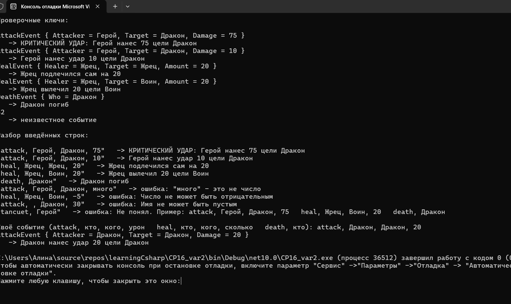



Вариант 2. Игровые события через записи

public record AttackEvent(string Attacker, string Target, int Damage);
public record HealEvent(string Healer, string Target, int Amount);
public record DeathEvent(string Who);
Метод string ToLogLine(object gameEvent) через switch-выражение:
AttackEvent { Damage: > 50 } (свойственный паттерн) — "КРИТИЧЕСКИЙ УДАР: ...".
AttackEvent a — обычная строка лога об атаке.
HealEvent h when h.Healer == h.Target (when, сравнение двух свойств друг с другом) — "... подлечился сам".
HealEvent h — обычная строка лога о лечении.
DeathEvent d — "... погиб".
_ — "неизвестное событие".

Проверочные ключи

new AttackEvent("Герой", "Дракон", 75) — "КРИТИЧЕСКИЙ УДАР: ..."
new AttackEvent("Герой", "Дракон", 10) — обычная строка лога об атаке
new HealEvent("Жрец", "Жрец", 20) — "... подлечился сам"
new HealEvent("Жрец", "Воин", 20) — обычная строка лога о лечении
new DeathEvent("Дракон") — "Дракон погиб"
