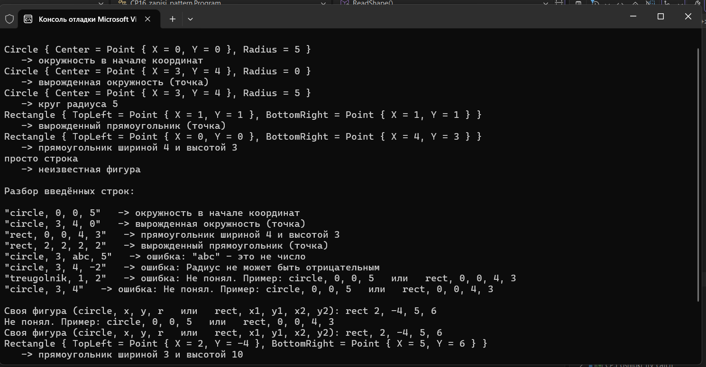



Вариант 1. Геометрические фигуры через записи

public record Point(double X, double Y);
public record Circle(Point Center, double Radius);
public record Rectangle(Point TopLeft, Point BottomRight);
Метод string Classify(object shape) через switch-выражение:
Circle { Center: { X: 0, Y: 0 } } (вложенный паттерн) — "окружность в начале координат".
Circle { Radius: 0 } — "вырожденная окружность (точка)".
Circle c — строка с радиусом.
Rectangle r when r.TopLeft == r.BottomRight — "вырожденный прямоугольник (точка)".
Rectangle r — строка с размерами.
_ — "неизвестная фигура".

Проверочные ключи

