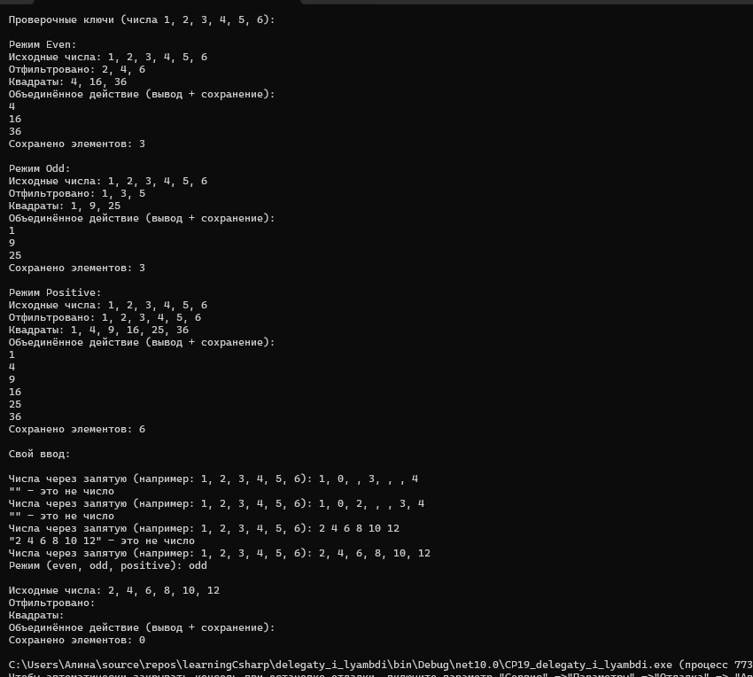
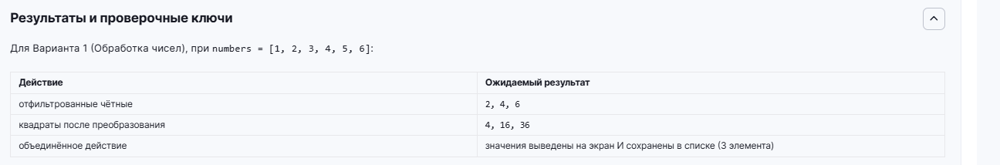



Вариант 1. Обработка чисел

List<int> numbers с произвольным набором положительных и отрицательных чисел.
Лямбда-фильтр Func<int, bool>: оставляет только чётные числа.
Лямбда-преобразование Func<int, int>: возводит число в квадрат.
Два лямбда-действия Action<int>, объединённые через += в один многоадресный делегат: одно выводит результат на экран, второе сохраняет его в отдельный список.
Конвейер: для каждого чётного числа вычислить квадрат и выполнить объединённое действие с результатом.

Дополнительно использован материал прошлых тем: перечисление FilterMode с режимами Even, Odd, Positive, switch-выражение, которое по режиму возвращает нужную лямбду, своё исключение InvalidNumberException, try/catch и ручной ввод через int.TryParse и Enum.TryParse.

Проверочные ключи

numbers = [1, 2, 3, 4, 5, 6]
отфильтрованные чётные - 2, 4, 6
квадраты после преобразования - 4, 16, 36
объединённое действие - значения выведены на экран и сохранены в списке (3 элемента)
