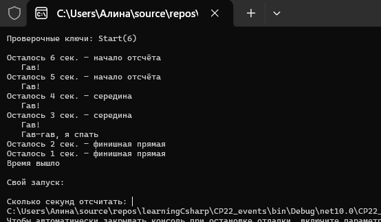
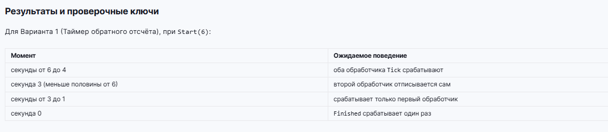



Вариант 1. Таймер обратного отсчёта

Класс Timer с событиями event EventHandler<int>? Tick (передаёт оставшиеся секунды) и event EventHandler? Finished.
Метод Start(int seconds), на каждом шаге уменьшающий счётчик и вызывающий Tick, а при достижении нуля - Finished.
На Tick подписаны два обработчика: один выводит оставшееся время, второй отписывается от Tick сам, как только оставшееся время становится меньше половины от начального.
На Finished подписан обработчик, выводящий итоговое сообщение.
Полный запуск показывает, что второй обработчик Tick перестаёт срабатывать на середине отсчёта, первый работает до конца, а Finished срабатывает один раз.

Дополнительно использован материал прошлых тем: перечисление TimerPhase с фазами Start, Middle, Final, switch-выражение с условием when для определения фазы и ещё одно switch-выражение для комментария к ней, своё исключение InvalidTimeException, try/catch и ручной ввод количества секунд через int.TryParse.

Проверочные ключи

Start(6)
секунды от 6 до 4 - оба обработчика Tick срабатывают
секунда 3 (меньше половины от 6) - второй обработчик отписывается сам
секунды от 3 до 1 - срабатывает только первый обработчик
секунда 0 - Finished срабатывает один раз
