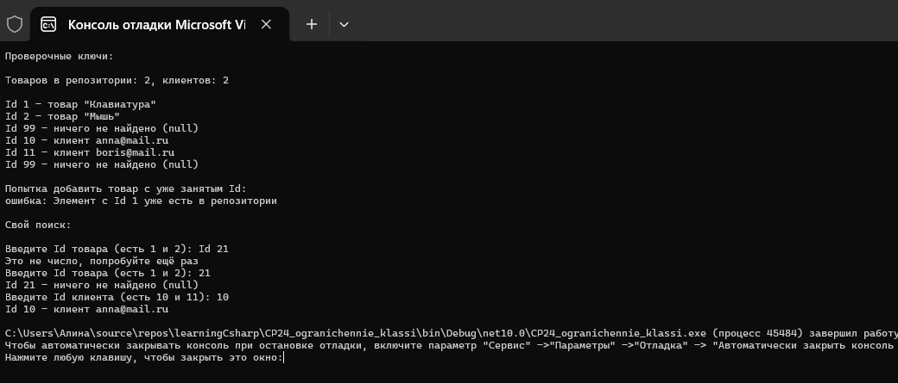
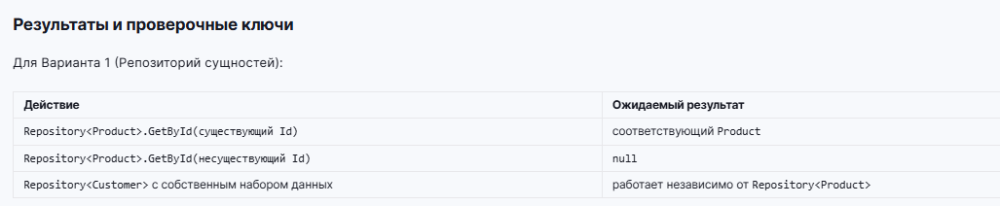



Вариант 1. Репозиторий сущностей

Базовый класс Entity со свойством int Id { get; init; }.
Обобщённый класс Repository<T> where T : Entity с методами Add(T item) и T? GetById(int id).
Производные классы Product : Entity (с дополнительным свойством Name) и Customer : Entity (с дополнительным свойством Email).
Создаются Repository<Product> и Repository<Customer>, в каждый добавляется по два элемента.
GetById показан для обоих репозиториев, включая случай, когда элемент с таким Id не найден.

Ограничение where T : Entity используется по назначению: внутри GetById свойство item.Id читается напрямую, без приведения типов.

Дополнительно использован материал прошлых тем: наследование и переопределение ToString(), свойства с init, своё исключение DuplicateIdException на повторный Id, try/catch, switch-выражение с null-паттерном при выводе результата поиска и ручной ввод Id через int.TryParse. Метод Show в Program.cs показывает вторую форму ограничения - ограничение обобщённого метода, а не класса.

Проверочные ключи

Repository<Product>.GetById(существующий Id) - соответствующий Product
Repository<Product>.GetById(несуществующий Id) - null
Repository<Customer> с собственным набором данных - работает независимо от Repository<Product>
