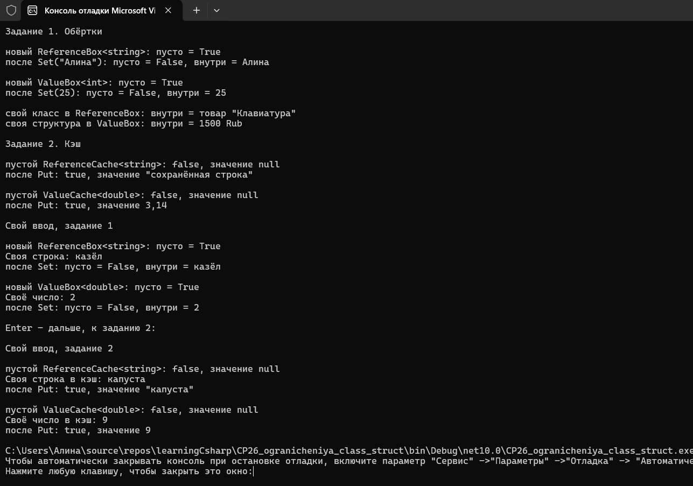
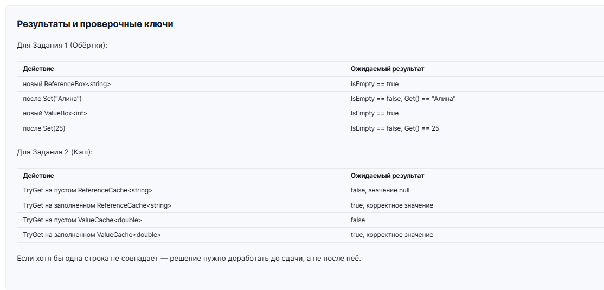



Необходимо реализовать оба задания.

Задание 1. Обёртки

ReferenceBox<T> where T : class с методами Set(T item), bool IsEmpty, T? Get(), использующий null как пустое состояние.
ValueBox<T> where T : struct с тем же набором методов, использующий Nullable<T> (T?) как пустое состояние.
Показан ReferenceBox<string> и ReferenceBox со своим классом: пустое и заполненное состояние.
Показан ValueBox<int> и ValueBox со своей структурой: пустое и заполненное состояние.
Закомментированным кодом показано, что ReferenceBox<int> и ValueBox<string> не компилируются.

Задание 2. Кэш

ReferenceCache<T> where T : class с методом bool TryGet(out T? value), возвращающим false и null, если кэш пуст, и true со значением иначе.
ValueCache<T> where T : struct с тем же по смыслу методом, использующим Nullable<T> внутри.
Показан ReferenceCache<string>: промах и попадание.
Показан ValueCache<double>: промах и попадание.
Закомментированным кодом показано, что ReferenceCache<double> и ValueCache<string> не компилируются.

Пустое состояние решается разными механизмами: в class-вариантах проверка value is null напрямую, в struct-вариантах - Nullable<T> и его HasValue, потому что у типа значения своего null нет.

Дополнительно использован материал прошлых тем: перечисление Currency, своя структура Money с переопределённым ToString(), свой класс Product, своё исключение InvalidInputException, try/catch, свойства с init, ручной ввод числа через double.TryParse с CultureInfo.InvariantCulture. Ручной ввод сделан отдельно для каждого задания.

Проверочные ключи

Задание 1
новый ReferenceBox<string> - IsEmpty == true
после Set("Алина") - IsEmpty == false, Get() == "Алина"
новый ValueBox<int> - IsEmpty == true
после Set(25) - IsEmpty == false, Get() == 25

Задание 2
TryGet на пустом ReferenceCache<string> - false, значение null
TryGet на заполненном ReferenceCache<string> - true, корректное значение
TryGet на пустом ValueCache<double> - false
TryGet на заполненном ValueCache<double> - true, корректное значение
