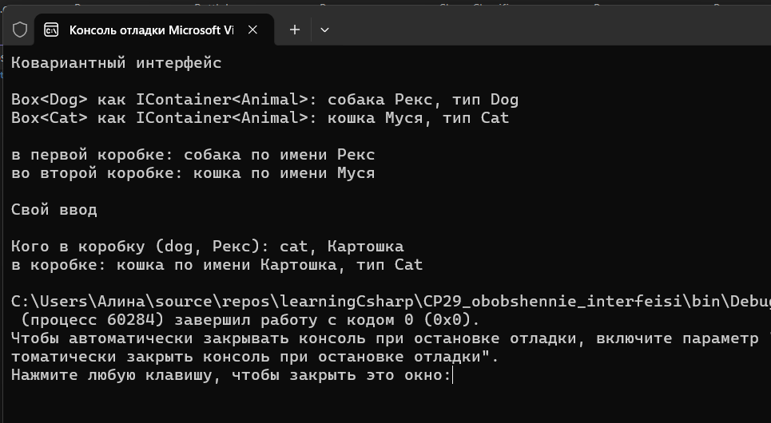
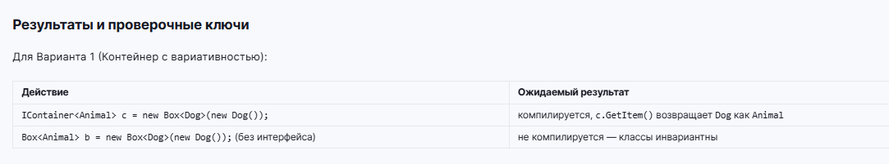



Вариант 1. Контейнер с вариативностью

interface IContainer<out T> { T GetItem(); }
Классы Animal и Dog : Animal (добавлен ещё Cat : Animal).
class Box<T> : IContainer<T>, хранящий и возвращающий значение типа T.
Box<Dog> присвоен переменной типа IContainer<Animal> - компилируется и работает, GetType().Name показывает, что внутри остался Dog.
Закомментированным кодом показано, что Box<Dog> напрямую не присваивается переменной Box<Animal> (CS0029), и что в IContainer<out T> нельзя добавить метод, принимающий T (CS1961).

Параметр типа T в интерфейсе стоит только в позиции возвращаемого значения - иначе ковариантность невозможна.

Дополнительно использован материал прошлых тем: наследование и переопределение ToString(), свойства с init, перечисление AnimalKind с Enum.TryParse и Enum.IsDefined, своё исключение InvalidAnimalException, try/catch, switch-выражение с паттернами по типу, ручной ввод через запятую.

Проверочные ключи

IContainer<Animal> c = new Box<Dog>(new Dog()); - компилируется, c.GetItem() возвращает Dog как Animal
Box<Animal> b = new Box<Dog>(new Dog()); - не компилируется, классы не вариативны
