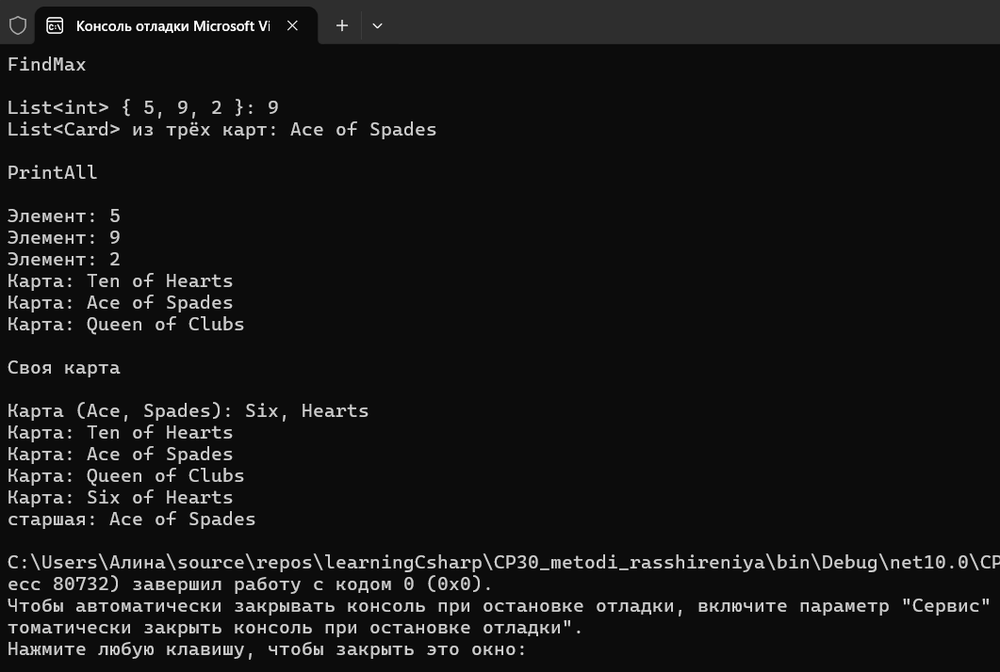



Вариант 2. Расширения с ограничением

Статический класс с методом расширения T? FindMax<T>(this IEnumerable<T> source) where T : IComparable<T>, возвращающим наибольший элемент последовательности.
Метод расширения void PrintAll<T>(this IEnumerable<T> source, string prefix), выводящий каждый элемент с заданным префиксом, без ограничения типа.
Собственная структура Card : IComparable<Card>, сравнение по достоинству.
FindMax показан на List<int> и на List<Card>.
PrintAll показан на обеих коллекциях.

Оба метода объявлены в статическом классе с модификатором this у первого параметра и вызываются как методы экземпляра: numbers.FindMax(), cards.PrintAll("Карта: "). Ограничение where T : IComparable<T> принадлежит методу FindMax, а не самому List - поэтому структуру Card пришлось научить сравниваться.

Дополнительно использован материал прошлых тем: перечисления Suit и Rank, структура с переопределённым ToString() и свойствами init, IComparable, своё исключение InvalidCardException, try/catch, Enum.TryParse с Enum.IsDefined, ручной ввод карты через запятую.

Проверочные ключи

new List<int> { 5, 9, 2 }.FindMax() - 9
коллекция собственного типа .FindMax() - элемент с наибольшим значением по критерию сравнения
PrintAll с префиксом "Элемент: " - каждая строка вывода начинается с этого префикса
