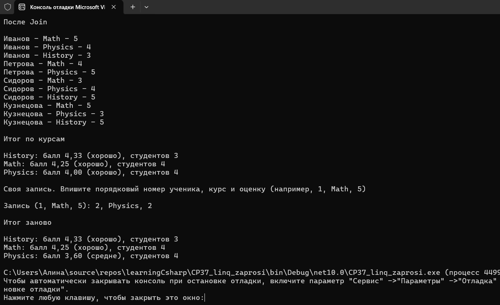
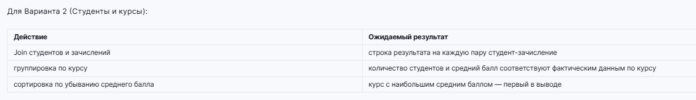



Вариант 2. Студенты и курсы

List<Student> (Id, имя) из пяти элементов.
List<Enrollment> (StudentId, курс, оценка) из одиннадцати элементов, связанных со студентами.
Коллекции соединены через Join по Id и StudentId.
Результат соединения сгруппирован по курсу, внутри каждой группы посчитан средний балл и количество студентов.
Курсы отсортированы по убыванию среднего балла, итог выведен сводкой.

Весь запрос написан методным синтаксисом LINQ одной цепочкой: Join, GroupBy, Select, OrderByDescending, внутри групп Average и Distinct().Count(). Ручной агрегации в переменных нет.

Студент Смирнов добавлен в список намеренно и ни на один курс не записан - в результат Join он не попадает, потому что его Id ни с чем не совпал.

Дополнительно использован материал прошлых тем: записи, перечисление Course с Enum.TryParse и Enum.IsDefined, своё исключение InvalidEnrollmentException, try/catch, switch-выражение с реляционными паттернами для подписи к баллу, int.TryParse и ручной ввод записи через запятую. После ручного ввода сводка считается заново, чтобы было видно, что запрос работает от текущих данных.

Проверочные ключи

Join студентов и зачислений - строка результата на каждую пару студент-зачисление
группировка по курсу - количество студентов и средний балл соответствуют фактическим данным по курсу
сортировка по убыванию среднего балла - курс с наибольшим средним баллом первый в выводе
