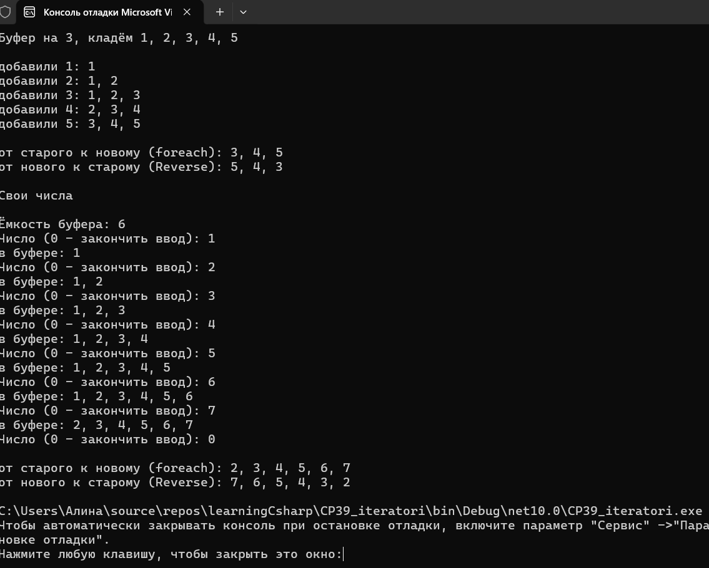



Вариант 1. Кольцевой буфер

class CircularBuffer<T> : IEnumerable<T> с фиксированной ёмкостью, заданной в конструкторе, хранящий данные во внутреннем массиве T[].
Метод Add(T item): если буфер не заполнен - добавляет в следующий свободный слот, если заполнен - переписывает самый старый элемент.
GetEnumerator() через yield return, обходящий элементы от самого старого к самому новому с учётом кольцевого сдвига индексов, а не в порядке физических ячеек массива.
Дополнительный метод IEnumerable<T> Reverse(), обходящий элементы от самого нового к самому старому.
Показано заполнение буфера до предела, добавление сверх предела с переписыванием старых элементов, обход через foreach и через Reverse().

Обход реализован только через yield return, список со всеми элементами заранее не строится. Сдвиг считается выражением (start + i) % items.Length: массив физически не двигается, двигается только индекс самого старого элемента.

Во втором блоке ёмкость и числа вводятся с клавиатуры, ноль заканчивает ввод.

Проверочные ключи

ёмкость 3, добавлены по очереди 1, 2, 3, 4, 5
foreach по буферу - 3, 4, 5 (1 и 2 переписаны, порядок от старого к новому)
Reverse() - 5, 4, 3
